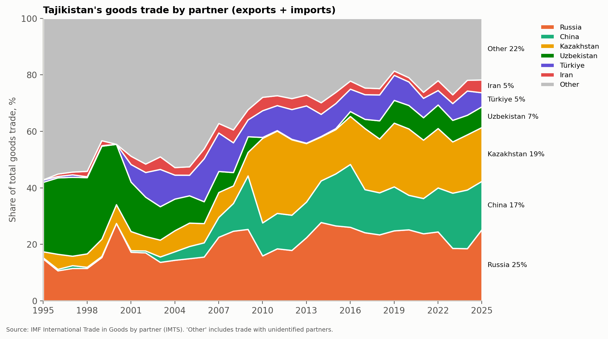
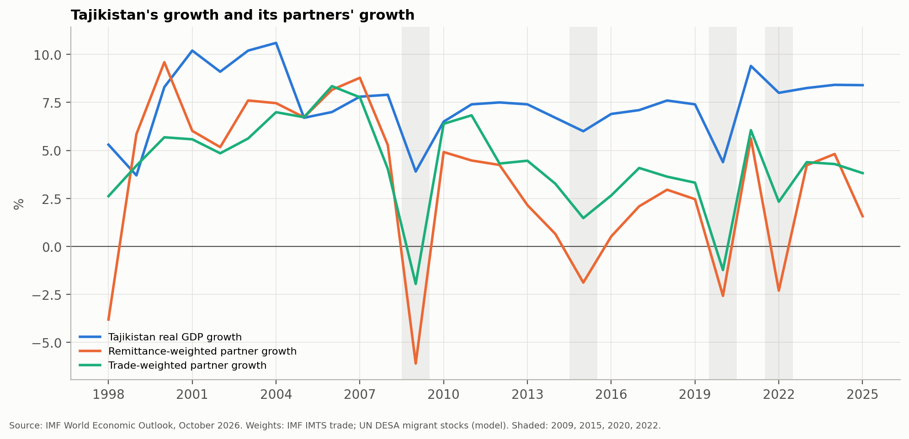
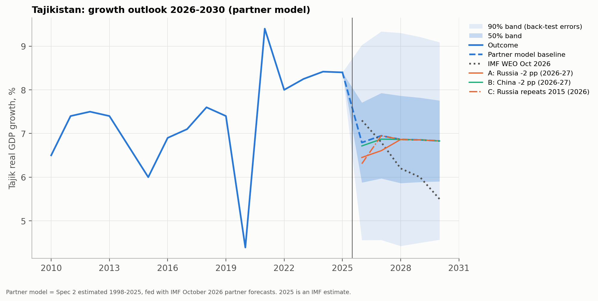

# Tajikistan Macro Monitor

How strongly is Tajikistan's growth tied to Russia, China and its other
partners, through trade and remittances, and what does that imply for its
growth to 2030?

The project builds trade-weighted and remittance-weighted partner growth
indices for Tajikistan and three neighbours, relates them to growth with a
small set of pre-stated regressions, and uses them to forecast Tajik growth
for 2026-2030. Forecasts are back-tested against the IMF's own past World
Economic Outlook (WEO) forecasts.

## Main results

Data: IMF WEO October 2026 and the other sources below; sample 1998-2025
(2025 = IMF estimate). Full numbers: `outputs/results_summary.md`.
Discussion: `note/note.md`. All results are associations, not causal
effects.

- **Exposure.** China's share of Tajik goods trade rose from 0.0% (2000)
  to 17.1% (2025); Russia's was 25.2% in 2025, Kazakhstan's 19.1%. China
  held 25.8% of Tajik public external debt in 2025 (US$738 million);
  debt owed to Russia was zero from 2008. Remittances were 57.7% of GDP in
  2025, an estimated 82.6% of them from Russia (model estimate).
- **Growth links.** A 1 pp rise in Russian growth is associated with
  0.28 pp higher Tajik growth (SE 0.07, N = 28). No link with Chinese
  growth is visible (-0.13, SE 0.10), but Chinese growth trends down over
  the sample, so this is not evidence of no link. The remittance-weighted
  index correlates 0.99 with Russian growth. In a 4-country panel,
  trade-weighted partner growth is associated with growth (0.72, SE 0.29,
  N = 112).
- **Forecasts.** One year ahead (2005-2023, N = 19), RMSE was 1.36 for
  the partner model, 1.72 for an AR(1), 2.02 for a naive forecast and
  2.48 for the IMF. IMF forecasts were on average 1.6-1.9 pp below the
  outcome at every horizon from one to five years. Our models use revised
  data the IMF did not have, so this shows an IMF downward bias for
  Tajikistan, not a better model.
- **Outlook.** Given IMF partner forecasts, the partner model gives
  6.8-7.0% growth a year in 2026-2030; the IMF projects 7.3% falling to
  5.5%. Russian growth 2 pp lower in 2026-27 lowers Tajik growth by
  0.34 pp a year (SE 0.15); the Chinese equivalent is -0.08 pp (SE 0.09).







All ten charts are in `outputs/figures/`.

## How to run

Requires Python 3.12.

```
python -m pip install -r requirements.txt
python main.py
```

`main.py` runs the seven steps in `src/` in order. On the first run it
downloads the data (a few minutes); later runs reuse the saved raw files and
finish in about a minute. If any check fails, the run stops with a message.

Two files cannot be downloaded by script. Save them in `data/raw/manual/`
with exactly these names:

| File | Source |
|---|---|
| `weohistorical.xlsx` | IMF Historical WEO Forecasts Database: https://www.imf.org/external/pubs/ft/weo/data/weohistorical.xlsx |
| `undesa_pd_2024_ims_stock_by_sex_destination_and_origin.xlsx` | UN DESA International Migrant Stock 2024, destination and origin: https://www.un.org/development/desa/pd/content/international-migrant-stock |

## Folder map

```
main.py                     runs everything
requirements.txt            package versions used
src/common.py               paths, settings, IMF data reader, chart style
src/country_codes.py        UN M49 -> ISO3 codes (checked against UN names)
src/01_get_data.py          downloads raw data + download log
src/02_build_database.py    cleaning, SQLite/CSV database, data-quality log
src/03_partner_weights.py   trade and remittance weights, partner indices
src/04_descriptives.py      descriptive charts, summary statistics
src/05_regressions.py       stationarity tests, three regressions
src/06_forecast.py          back-test, 2026-2030 baseline, scenarios
src/07_results_summary.py   collects key numbers into one file
data/raw/                   untouched downloads; download_log.csv
data/processed/             tidy tables, macro_monitor.sqlite,
                            data_quality_log.md
outputs/figures/            charts (PNG)
outputs/tables/             tables (CSV and Markdown)
note/note.md                two-page note
```

## Data

| Data | Source | Access |
|---|---|---|
| Real GDP growth, inflation, current account, government debt, GDP (US$), all countries incl. projections to 2031 | IMF WEO, October 2026 (dataflow IMF.RES:WEO) | IMF SDMX 3.0 API |
| Growth projections, April 2026 edition | IMF WEO_2026_APR_VINTAGE | IMF SDMX 3.0 API |
| Goods exports and imports by partner country | IMF International Trade in Goods by partner (IMF.STA:IMTS) | IMF SDMX 3.0 API |
| Remittances (US$, % of GDP), exchange rate, public external debt, GNI per capita PPP | World Bank WDI | World Bank API v2 |
| Public external debt owed to China and Russia | World Bank International Debt Statistics | World Bank API v2 (source 6) |
| Past IMF forecasts (editions 1990-2022) | IMF Historical WEO Forecasts Database | manual download |
| Migrants by country of origin and destination | UN DESA International Migrant Stock 2024 | manual download |

Download dates and exact URLs are in `data/raw/download_log.csv`. The WEO
edition is checked by the code (`COUNTRY_UPDATE_DATE` must be from the
autumn 2026 round).

## Methods (fixed before running the analysis)

**Sample.** Annual data, 1998-2025. Tajikistan's civil war ended in 1997.
2025 values are IMF estimates.

**Trade weights.** Partner p's share of a country's goods trade (exports +
imports CIF) in year t, with the IMF world total as denominator. The index
for year t uses year t-1 weights.

**Remittance weights.** Bilateral remittances are not observed. They are
rebuilt with the World Bank/KNOMAD method (Ratha and Shaw 2007), as
documented by Huckstep and Clemens (CGD, 2026): each destination country j
gets weight proportional to M_ij x s_ij, where M_ij is the UN migrant stock
from origin i living in j and s_ij = Y_i if Y_j < Y_i, else
Y_i + (Y_j - Y_i)^0.75, with Y = GNI per capita (PPP). Stocks are
interpolated between UN years and held at 2024 levels after.

**Partner indices.** Weighted averages of partners' real GDP growth (WEO
October 2026, history and projections).

**Regressions** (Newey-West standard errors, 1 lag; associations only):
1. Tajik growth on Russian and Chinese growth.
2. Tajik growth on the trade-weighted and remittance-weighted indices.
3. Specification 2 as a panel of Tajikistan, Kyrgyz Republic, Uzbekistan
   and Kazakhstan with country fixed effects (Newey-West within country).

ADF and KPSS tests are reported for every series. The Newey-West standard
errors of specification 1 are also computed by hand and checked against
statsmodels. After the first run, two diagnostics were added: a joint Wald
test of the partner coefficients in each specification, and the
correlation matrix of the regressors. The specifications were not changed.

**Forecasts.** From each autumn origin (2004-2022) we forecast 1-5 years
ahead with a naive forecast, an AR(1), and the specification-2 model fed
with the IMF's own partner forecasts from that edition. These are compared
with the IMF's forecast for Tajikistan from the same edition (MAE, RMSE,
common sample of years). The 2026-2030 baseline uses the October 2026
partner projections. Scenarios: (A) Russian growth 2 pp below baseline in
2026-27; (B) Chinese growth 2 pp below baseline in 2026-27; (C) Russia
repeats its 2015 growth in 2026. Fan-chart bands come from back-test
errors.

## Limitations

- Small annual samples (about 28 years for Tajikistan). Results are
  associations, not causal effects.
- Remittance weights are model estimates. UN migrant stocks count people
  by place of birth: they include people who moved within the Soviet Union
  before 1991 and miss many seasonal workers.
- The remittance index is dominated by Russia, so it is hard to separate
  from Russian growth.
- Back-test outcomes come from the October 2026 WEO, which includes later
  revisions. Our models use revised data the IMF did not have when it
  forecast, which favours our models.
- The IMF historical forecasts file ends with the autumn 2022 edition, so
  one-year-ahead comparisons stop at 2023.
- Official Tajik growth data are unusually smooth; low variation makes
  links with partner growth hard to detect. In 2014-16 Tajik remittances
  in US$ halved while official growth stayed at 6-7%.
- Chinese growth is not stationary over the sample (ADF p = 0.81, KPSS
  p = 0.04), so its regression coefficient mainly compares trends.
- Trade weights follow where goods are shipped, not who buys them. For
  Uzbekistan, 22-52% of exports have no partner country since 2016.
- Estimated remittance sources for Kazakhstan and Uzbekistan reflect
  Soviet-era birthplaces (e.g. Germany for Kazakhstan); Kazakhstan's
  remittances are below 1% of GDP. Kyrgyz remittance data appear revised
  and end in 2024.
