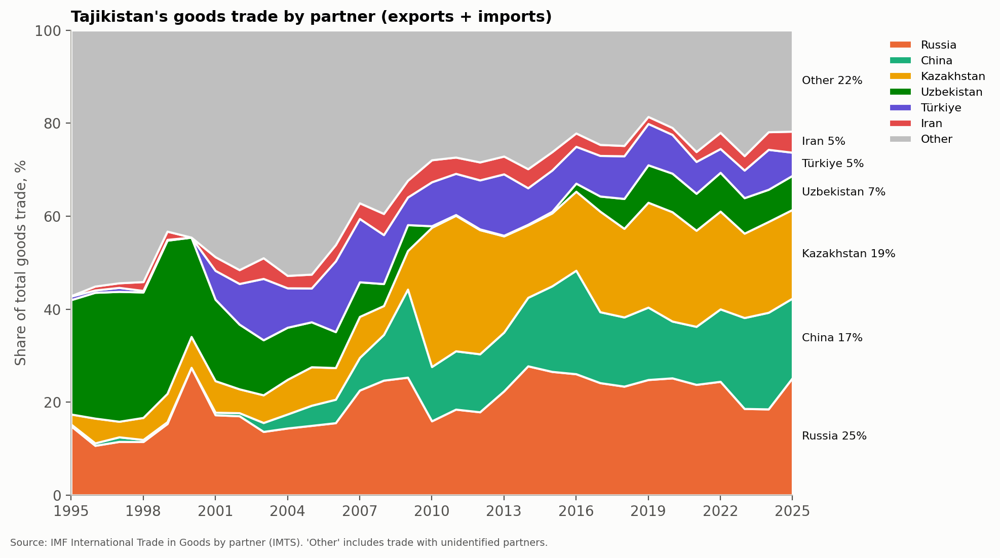
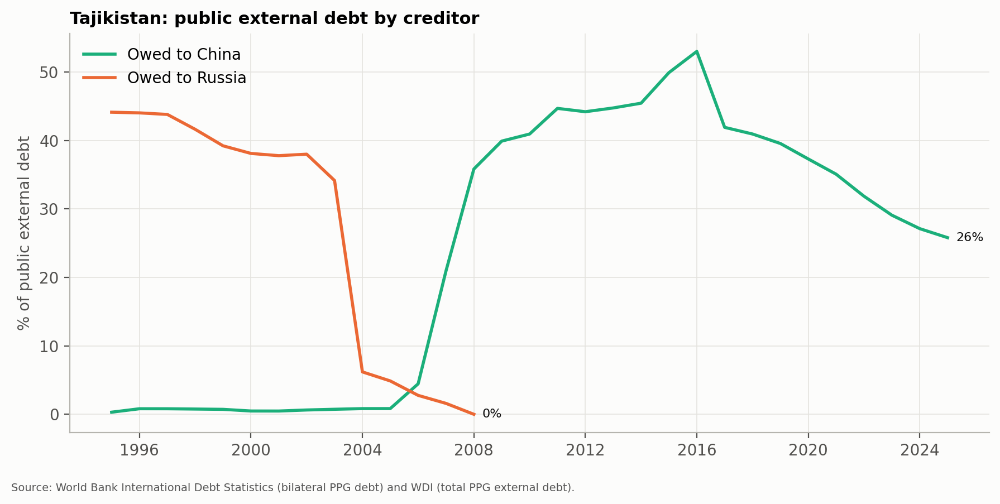
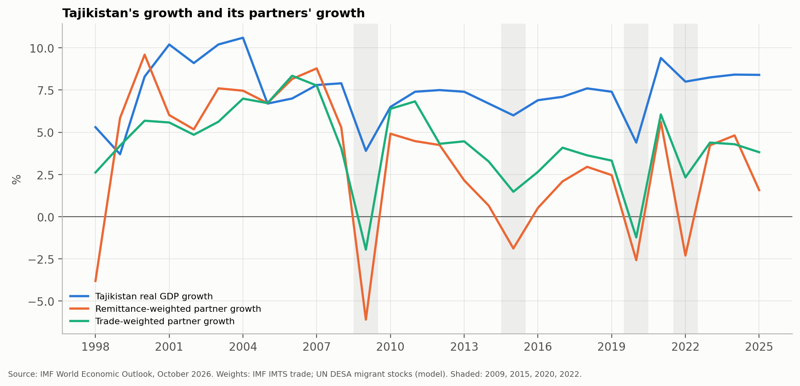
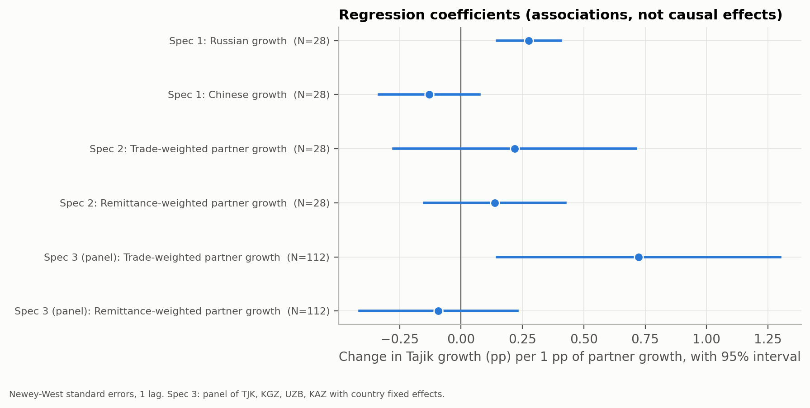
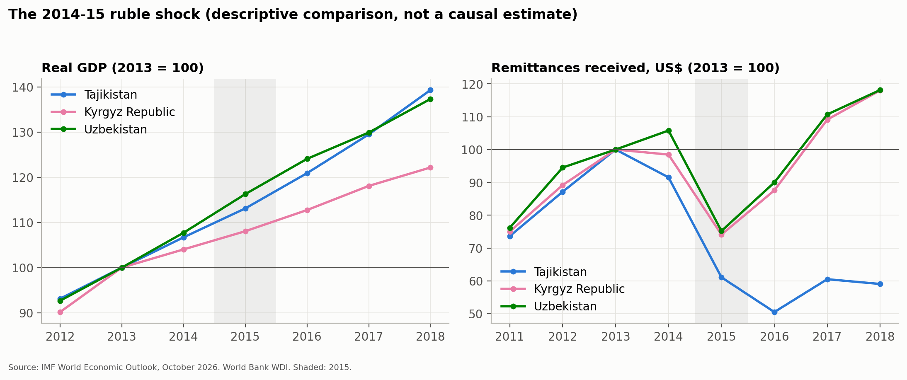
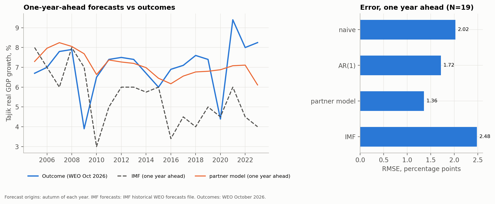
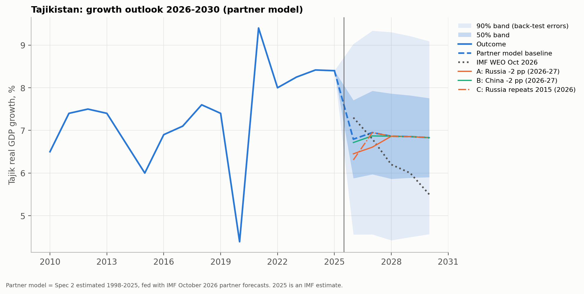

# Tajikistan and its partners: growth links and an outlook to 2030

*November 2026. All numbers come from `outputs/results_summary.md` and the
charts in `outputs/figures/`, produced by the code in this repository.*

## Question

Tajikistan has reported real GDP growth of 6 to 9 percent in most years
since 2010. Remittances, mostly from Russia, were 57.7 percent of GDP in
2025, and China has become a large trade partner and lender. This note
asks two things. How closely does Tajik growth move with growth in Russia,
China and its other partners? And what does that imply for 2026-2030?

## Data and approach

Annual data for 1998-2025 (the civil war ended in 1997; 2025 values are
IMF estimates). Sources: IMF World Economic Outlook, October 2026; IMF
goods trade by partner; World Bank WDI and International Debt Statistics;
UN DESA migrant stocks 2024; and the IMF file of past WEO forecasts
(editions 1990-2022).

I build two partner growth indices. The trade-weighted index averages
partners' growth using their share of Tajik goods trade in the previous
year. The remittance-weighted index uses estimated shares of remittances
by sending country. Bilateral remittances are not published, so I rebuild
them with the World Bank/KNOMAD method from UN migrant stocks and income
levels. These shares are model estimates. Three regressions were fixed
before looking at the data, with Newey-West standard errors. All results
are associations in a small sample, not causal effects.

## Finding 1: China gained ground in trade and debt, but Russia did not lose it

| Share of Tajik goods trade | 2000 | 2010 | 2020 | 2025 |
|---|---|---|---|---|
| Russia | 27.4% | 15.9% | 25.2% | 25.2% |
| China | 0.0% | 11.7% | 12.2% | 17.1% |
| Kazakhstan | 6.6% | 29.9% | 23.5% | 19.1% |

China went from almost nothing to 17 percent of Tajik goods trade.
Russia's share is the same in 2025 as in 2020, and Kazakhstan matters about
as much as China. In public external debt the shift is clearer: debt owed
to Russia fell to zero by 2008. Debt owed to China rose to roughly half
of the total by 2016 and was 25.8 percent (US$738 million) in 2025.
Remittances stay a Russian channel: the model puts 82.6 percent of them in
Russia in 2025.

## Finding 2: Tajik growth moves with Russia; a link with China is not visible

In Spec 1 (N = 28, 1998-2025), a 1 percentage point rise in Russian
growth goes with Tajik growth about 0.28 points higher (SE 0.07). That is
modest for an economy where remittances are half of GDP. The coefficient
on Chinese growth is -0.13 (SE 0.10), not distinguishable from zero.
It also cannot be read as evidence of no link: Chinese growth trends down
over the sample (ADF p = 0.81, KPSS p = 0.04), so the regression mostly
compares trends.

In Spec 2 neither index is significant alone (trade-weighted 0.22,
SE 0.25; remittance-weighted 0.14, SE 0.15), but the two are jointly
significant (chi-squared 15.9, p < 0.001). The reason is that they carry
almost the same information. The remittance-weighted index has a
correlation of 0.99 with Russian growth, because the estimated weights are
dominated by Russia. In the panel of Tajikistan, the Kyrgyz Republic,
Uzbekistan and Kazakhstan (N = 112), trade-weighted partner growth is
associated with growth (0.72, SE 0.29); the remittance index is not
(-0.09, SE 0.16).

## Finding 3: official Tajik growth barely reacts to large shocks

The 2014-15 ruble shock is the clearest test. By 2016, Tajik remittances
in US dollars had fallen to about half of their 2013 level and were still
near 60 percent of it in 2018. Remittances to the Kyrgyz Republic and
Uzbekistan fell by about a quarter in 2015 and recovered by 2017. Yet
official Tajik growth stayed at 6 to 7 percent. Such a smooth series
limits what any regression can detect, and it is a reason to read the
coefficients above as lower bounds on exposure.

## Finding 4: IMF forecasts for Tajikistan have been persistently too low

I forecast Tajik growth from each autumn between 2004 and 2022 and compare
with the IMF's forecast made at the same time (19 target years,
2005-2023).

| One year ahead | RMSE | Mean error |
|---|---|---|
| Naive (last year's growth) | 2.02 | 0.12 |
| AR(1) | 1.72 | 0.52 |
| Partner model (Spec 2) | 1.36 | 0.04 |
| IMF WEO, autumn edition | 2.48 | -1.59 |

The IMF's mean error is between -1.6 and -1.9 points at every horizon from
one to five years: it has expected slower growth than Tajikistan then
reported. For 2023, for example, the autumn 2022 WEO expected about
4 percent; the outcome was 8.25 percent. The most recent revision points
the same way. Between April and October 2026 the IMF raised its 2026
forecast from 6.0 to 7.3 percent and its 2027 forecast from 4.8 to 6.8.

This is not evidence that my model forecasts better than the IMF. My
models are estimated on data as revised by 2026, which the IMF did not
have. Much of their advantage comes from staying close to Tajikistan's
own high average growth. And 19 years are too few for a formal test.

## Outlook for 2026-2030

With the IMF's October 2026 forecasts for partner growth, the partner
model gives Tajik growth of 6.8 to 7.0 percent a year to 2030. The IMF
projects a slowdown from 7.3 percent in 2026 to 5.5 percent in 2030. That
slowdown comes from country-specific judgment, which a model built only on
partner growth cannot capture. The right reading is that partner
conditions alone do not imply a slowdown, not that growth will stay at
7 percent.

The scenarios give small effects. Russian growth 2 points lower in
2026-27 lowers Tajik growth by 0.34 points a year (SE 0.15). A repeat of
Russia's 2015 contraction in 2026 lowers it by 0.49 points (SE 0.21).
Chinese growth 2 points lower changes it by -0.08 points (SE 0.09), not
distinguishable from zero. Given Finding 3, these effects are probably
too small.

## Limitations

- Small annual samples (28 years for Tajikistan). Associations only.
- Remittance shares are model estimates. UN migrant stocks count people by
  birthplace, so they include Soviet-era movers and miss many seasonal
  workers.
- Trade weights follow where goods are shipped, not who buys them
  (e.g. the Netherlands in Tajik trade in 2000). For Uzbekistan, 22-52
  percent of exports have no partner country since 2016.
- Kyrgyz remittance data appear revised and end in 2024.
- The joint tests and correlations in Finding 2 were added after the first
  run as diagnostics; the three specifications were not changed.
- The IMF forecast file ends with the autumn 2022 edition, so one-year
  comparisons stop at 2023, and the outcomes themselves are revised data.
